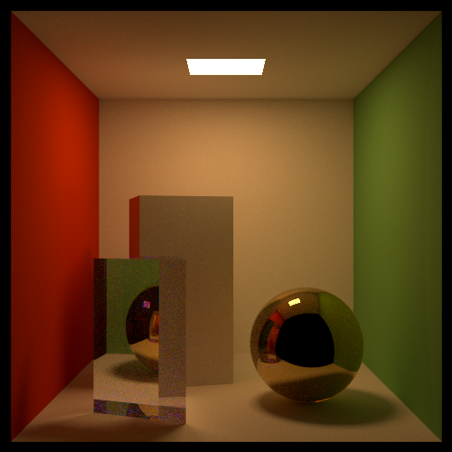
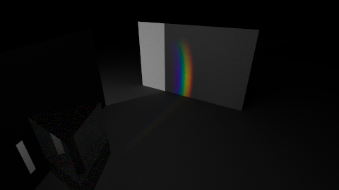
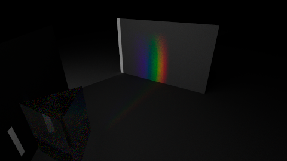
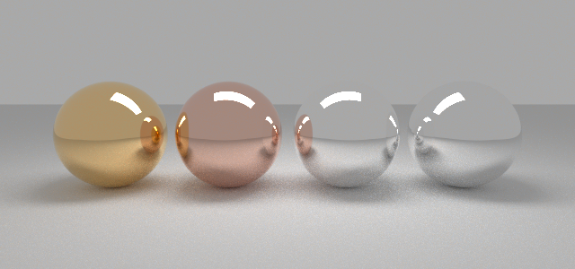
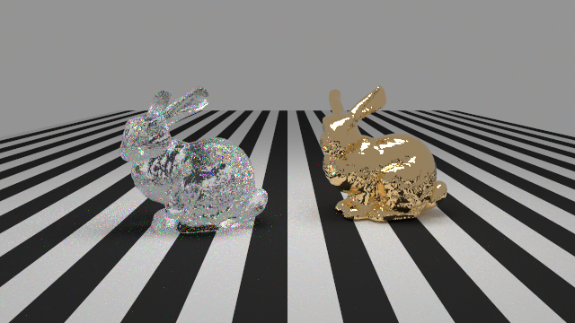
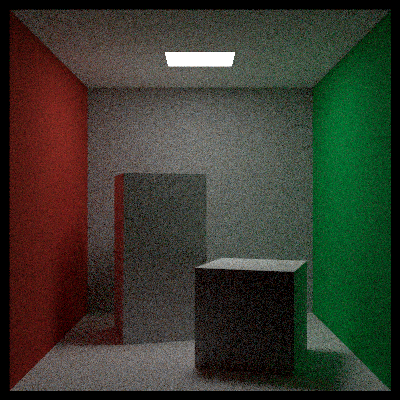
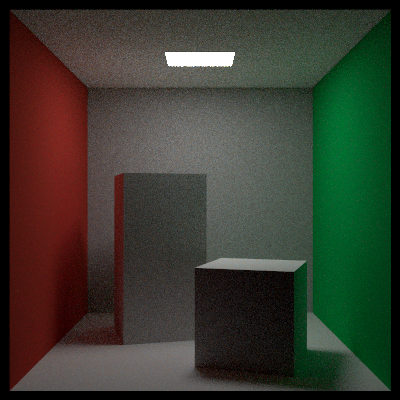

# Spectral Ray Tracer

[](https://github.com/Finnley111/ray_tracer/actions/workflows/ci.yml)

A physically based path tracer that works in **wavelengths instead of RGB**. This is what makes glass split white light into a rainbow, and what makes gold and copper come out the right colour from their measured optical constants. It is written in C++20 with no external dependencies (the PNG writer is hand-rolled too).



*A 3000 K blackbody light, an SF11 flint-glass prism (Sellmeier dispersion) and a gold sphere (measured complex IOR). The walls are authored in RGB and converted to spectra. 500×500, hybrid camera/light tracing, about 4 minutes on 8 threads.*

## Features

**Spectral core**
- Hero-wavelength sampling (Wilkie et al. 2014): each path carries 4 wavelengths. The 3 companion wavelengths are dropped when a path refracts through dispersive glass, because only one wavelength can follow a given refracted direction.
- CIE 1931 colour matching functions (Wyman 2013 fit), conversion from XYZ to linear sRGB, a D65 table and Planck blackbody emitters.
- RGB to spectrum for reflectances (Smits 1999), so scenes can be authored in RGB.

**Materials**
- Lambertian diffuse and perfect mirrors.
- Conductors with a wavelength-dependent complex IOR, using measured data for gold, silver and copper (Johnson & Christy).
- Dispersive dielectrics: Sellmeier with Schott catalogue coefficients (BK7, SF11) or Cauchy, with exact Fresnel and total internal reflection.

**Light transport**
- Path tracing with Russian roulette.
- Next-event estimation combined with BSDF sampling by multiple importance sampling (power heuristic).
- A **hybrid renderer** for caustics: light tracing for paths whose first visible surface is diffuse, camera paths for everything else. The two sets of paths are disjoint, so nothing is counted twice.
- **Bidirectional path tracing** with balance-heuristic MIS, computed from pdf ratios (Veach 1997, pbrt-v4 style).
- An optional luminance clamp to remove fireflies. It is biased: it makes the showcase about 0.1% darker overall.

**Engine**
- Binned-SAH BVH over spheres, quads and triangles.
- Multithreaded rendering, deterministic for any thread count: each row seeds its own RNG.
- OBJ loader, a line-based scene file format with `file:line` error messages, and PNG/PPM output.

## Gallery

| | |
|---|---|
|  |  |
| **SF11 prism.** A slit beam deviates 67.2°, with a 2.8° spread from 450 to 650 nm. Brute-force path tracing can't find this path (about 1 hit in 10⁴ samples), so it is rendered with light tracing. | **Exaggerated dispersion** (Cauchy A = 1.5, B = 0.05): a 6.9° spread, which also throws a faint rainbow onto the floor. |
|  |  |
| **Measured metals.** None of these colours is painted on. They come from the Fresnel equations with each metal's measured complex IOR across 380–780 nm. | **Meshes:** the Stanford bunny (about 70k triangles) in BK7 glass and gold, through the BVH. |

## Measured results

Every renderer is checked against the others, not just eyeballed. `rt_tests` asserts all of these.

| Check | Result |
|---|---|
| White furnace (energy conservation): diffuse, dispersive glass, many-bounce interior | within 1–2% of the analytic value |
| BVH vs brute-force intersection, 20,000 random rays | identical hit, t and material |
| Hybrid vs plain path tracer, mean | within 0.5% |
| BDPT vs path tracer, mean (3 scenes) | within 0.7% |
| BDPT MIS weights over every strategy for one path | sum to 1.000000 |
| Smits RGB → spectrum → RGB round trip | worst channel error 0.067 |

Benchmarks (8 threads):

| | |
|---|---|
| BVH, 10k-triangle mesh | **87× faster** than a linear scan (1.61 s → 0.019 s), pixel-identical |
| NEE + MIS at 64 spp vs BSDF sampling at 1024 spp | **1.93× less noise with 1/16 the samples** (4.0 s vs 33.6 s), means agree to 0.16% |

<table><tr>
<td><br>BSDF sampling only, 1024 spp, 33.6 s</td>
<td><br>NEE + MIS, 64 spp, 4.0 s</td>
</tr></table>

### A negative result: BDPT vs the hybrid

I implemented full BDPT expecting it to clean up the prism and the gold sphere's reflections. At equal render time it **didn't**: 1.02× better in the prism region, 0.99× on the gold, and 0.89× overall. To find out why, I rendered variants of the scene with the hybrid renderer:

| Variant | Noise, prism region | Noise, gold region |
|---|---|---|
| SF11 prism | 0.0836 | 0.0310 |
| Non-dispersive prism (n = 1.79) | 0.0717 | 0.0266 |
| No prism | 0.0094 | 0.0186 |

Dispersion explains only about 14% of the prism noise. The rest comes from **specular → diffuse → specular** paths: the floor seen *through* the prism, lit by light that also came *through* the prism. Every BDPT connection has to join two non-specular vertices, and an SDS path has none to join except the diffuse one in the middle, so no connection strategy can sample it. The fix is photon mapping or VCM (vertex connection and merging), which adds "merging" on top of BDPT. BDPT stays in the codebase as an opt-in renderer (`renderer bdpt`): it is correct, and it is the only renderer here that handles both caustics and a background light.

## Build and run

Requires CMake ≥ 3.20 and a C++20 compiler (tested with g++ 15).

```bash
cmake -S . -B build -DCMAKE_BUILD_TYPE=Release && cmake --build build -j
./build/rt_tests
./build/rt scenes/example.txt renders/example.png
./build/rt showcase renders/showcase.png
```

Run `./build/rt` with no arguments to list the built-in scenes. The optional last argument overrides samples per pixel (or light paths per pixel for hybrid scenes).

The bunny scene needs the mesh, which is not committed:

```bash
mkdir -p assets && curl -fL https://raw.githubusercontent.com/alecjacobson/common-3d-test-models/master/data/stanford-bunny.obj -o assets/bunny.obj
```

### Scene files

```text
image 400 400
spp 256
camera 278 278 -800  278 278 0  40
renderer hybrid 512        # pt | hybrid LIGHT_PATHS_PER_PIXEL | bdpt
clamp 5                    # optional firefly clamp

material red   diffuse rgb 0.65 0.05 0.05
material lamp  light d65 15
material gold  conductor gold
material glass dielectric sf11

sphere 170 100 170  100  glass
quad 343 554 332  -130 0 0  0 0 -105  lamp
```

The full grammar is documented at the top of [`src/scene_file.h`](src/scene_file.h). See [`scenes/`](scenes/) for complete examples.

## Layout

| Path | Contents |
|---|---|
| `src/spectrum.h`, `src/color.h` | spectra, wavelength sampling, CIE colour science |
| `src/material.h`, `src/metals.h` | materials, Fresnel, measured metal data |
| `src/geometry.h`, `src/camera.h` | shapes, BVH, light sampling, pinhole camera |
| `src/integrator.h` | path tracer (NEE + MIS), light tracer, hybrid |
| `src/bdpt.h` | bidirectional path tracer |
| `src/scene_file.h`, `src/obj.h`, `src/image.h` | I/O |
| `tests/tests.cpp` | `assert`-based checks |
| `plan/`, `tickets/` | design doc and the ticket history, including what was tried and measured |

## References

- E. Veach, *Robust Monte Carlo Methods for Light Transport Simulation*, PhD thesis, 1997.
- M. Pharr, W. Jakob, G. Humphreys, *Physically Based Rendering*, 4th ed.
- A. Wilkie et al., "Hero Wavelength Spectral Sampling", EGSR 2014.
- C. Wyman, P.-P. Sloan, P. Shirley, "Simple Analytic Approximations to the CIE XYZ Color Matching Functions", JCGT 2013.
- B. Smits, "An RGB-to-Spectrum Conversion for Reflectances", JGT 1999.
- P. B. Johnson, R. W. Christy, "Optical Constants of the Noble Metals", Phys. Rev. B 6, 1972 (via refractiveindex.info).

## License

MIT. See [LICENSE](LICENSE).
